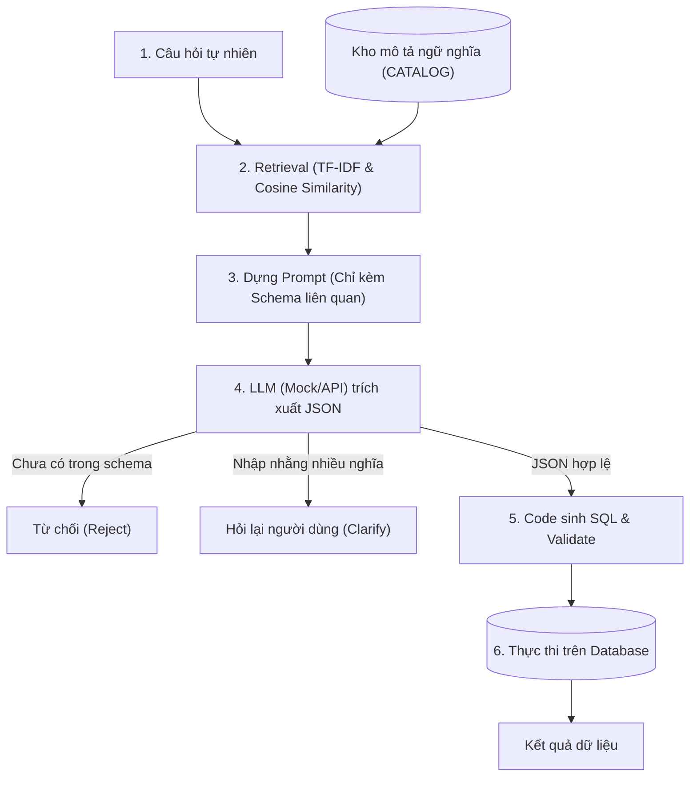

# Demo NLQ (Natural Language Query to SQL)

Dự án mẫu minh họa các phương pháp tiếp cận trong việc chuyển đổi câu hỏi bằng ngôn ngữ tự nhiên (Natural Language) thành truy vấn cơ sở dữ liệu (SQL), từ phương pháp **Rule-based (Dựa trên luật & Biểu thức chính quy)** đến kiến trúc **Semantic Layer + RAG + LLM (Mô hình Text-to-SQL tiêu chuẩn doanh nghiệp)**.

---

## 📂 Cấu trúc thư mục

```text
demo nlq/
├── 2_demo_nlq_rules.py       # Cách tiếp cận 1: Dựa trên Luật (Regex & Từ điển)
├── 3_demo_nlq_llm_mock.py    # Cách tiếp cận 2: Kiến trúc Hiện đại (RAG + Semantic Catalog + LLM)
└── README.md                 # Tài liệu hướng dẫn dự án
```

---

## 🔍 Chi tiết các phương pháp

### 1. Cách tiếp cận 1: Rule-based (`2_demo_nlq_rules.py`)

Phương pháp truyền thống, tách biệt rõ ràng giữa giai đoạn **Hiểu ý định** và **Ánh xạ lược đồ cơ sở dữ liệu**.

#### Luồng xử lý (5 bước):
1. **[A] Hiểu (Understand):** Dùng Regex và danh sách từ khóa để trích xuất các thành phần:
   - `metric_word`: Chỉ số cần đo lường (*"doanh thu"*, *"doanh số"*).
   - `dim_word`: Chiều dữ liệu cần gom nhóm (*"sản phẩm"*, *"mặt hàng"* kết hợp cùng từ nối *từng/theo/mỗi*).
   - `year`: Xử lý thời gian tuyệt đối (*2025*) hoặc tương đối (*"năm ngoái"*, *"năm nay"* dựa trên mốc thời gian hiện tại).
   - `top1`: Nhận diện xếp hạng (*"cao nhất"*, *"bán chạy nhất"*).
2. **[B] Ánh xạ (Link Schema):** Ánh xạ từ tự nhiên sang cấu trúc DB:
   - Từ người dùng $\rightarrow$ Tên cột / biểu thức SQL (`doanh thu` $\rightarrow$ `revenue` $\rightarrow$ `SUM(amount)`).
3. **[C] Sinh SQL (Build SQL):** Sinh câu truy vấn có **tham số hóa** (`WHERE year = ?`), tuyệt đối không nối chuỗi trực tiếp.
4. **[D] Kiểm tra an toàn (Validate):**
   - Chỉ chấp nhận câu lệnh `SELECT`.
   - Cấm dấu chấm phẩy `;` (ngăn chaining SQL injection).
   - Kiểm tra danh sách bảng hợp lệ (`ALLOWED_TABLES`).
5. **[E] Thực thi (Execute):** Chạy trên SQLite in-memory và trả về kết quả. Nếu câu hỏi chứa chỉ số chưa có trong từ điển (ví dụ: *"lợi nhuận"*), hệ thống dứt khoát từ chối thay vì suy đoán sai.

---

### 2. Cách tiếp cận 2: Semantic Catalog + RAG + LLM (`3_demo_nlq_llm_mock.py`)

Mô phỏng kiến trúc Text-to-SQL thực tế trong các hệ thống BI / Phân tích dữ liệu doanh nghiệp hiện đại.

#### Sơ đồ kiến trúc:



#### Các nguyên lý cốt lõi:
1. **Lớp ngữ nghĩa (Semantic Layer / Catalog):**
   - Định nghĩa trước các chỉ số (`metric`: `revenue`, `units_sold`, `headcount`), các chiều (`dimension`: `product`, `region`, `department`), và thời gian (`time`: `year`).
   - Khai báo danh sách từ đồng nghĩa (`syn`) cho từng mục.
2. **Schema Retrieval (RAG):**
   - Dùng TF-IDF kết hợp Cosine Similarity để tìm các mục schema phù hợp nhất với câu hỏi.
   - Giúp giảm độ dài prompt, tiết kiệm token và tránh làm mô hình bị phân tâm bởi các bảng không liên quan.
3. **Không để LLM sinh SQL thô trực tiếp:**
   - LLM chỉ đóng vai trò phân tích câu hỏi và trả về cấu trúc JSON đã được định nghĩa (`metric`, `group_by`, `year`, `top_n`).
   - Việc sinh mã SQL do code lập trình đảm nhiệm, đảm bảo cú pháp luôn đúng và kiểm soát bảo mật tuyệt đối.
4. **Xử lý tính mơ hồ & An toàn:**
   - **Chủ động hỏi lại (`clarify`):** Từ *"bán chạy"* có thể hiểu theo doanh thu (`revenue`) hoặc số lượng bán (`units_sold`). Hệ thống phát hiện đụng độ và yêu cầu người dùng xác nhận lại.
   - **Từ chối dứt khoát (`error`):** Những khái niệm chưa được mô tả trong catalog (như *"lợi nhuận"*) sẽ bị từ chối, ngăn chặn hiện tượng ảo giác (hallucination).
   - **Chống tấn công độc hại:** Bất kỳ chuỗi độc hại nào lọt vào spec JSON (ví dụ: `{"metric": "x; DROP TABLE sales"}`) đều bị lớp kiểm tra logic và whitelist chặn lại trước khi sinh SQL.

---

## ⚖️ Bảng so sánh 2 phương pháp

| Đặc điểm | Rule-based (`2_demo_nlq_rules.py`) | Semantic + LLM (`3_demo_nlq_llm_mock.py`) |
| :--- | :--- | :--- |
| **Bản chất** | Biểu thức Regex + IF-ELSE | Semantic Catalog + RAG + LLM Parsing |
| **Khả năng mở rộng** | Khó mở rộng khi thêm bảng / trường dữ liệu mới | Dễ dàng (chỉ cần thêm cấu hình vào `CATALOG`) |
| **Độ linh hoạt ngôn ngữ** | Thấp (chỉ hiểu câu theo khuôn mẫu đã lập trình) | Cao (hiểu nhiều cách diễn đạt tự nhiên khác nhau) |
| **Xử lý nhập nhằng** | Thường chọn mặc định hoặc bỏ qua | Chủ động hỏi lại (`clarify`) |
| **Phương thức sinh SQL** | Code ghép lệnh có tham số hóa | Code sinh lệnh từ JSON cấu trúc do LLM trích xuất |
| **Phòng chống Injection** | Kiểm tra Regex đơn giản | Whitelist trường dữ liệu + Validator đa tầng |

---

## 🚀 Hướng dẫn chạy thử nghiệm

### Yêu cầu môi trường
- Python 3.8 trở lên (không cần cài thêm thư viện ngoài, dùng thư viện chuẩn `sqlite3`, `re`, `json`, `math`).

### Chạy trên Windows (PowerShell)
> [!IMPORTANT]
> Trên hệ điều hành Windows, do terminal mặc định có thể dùng mã trang (codepage) không phải UTF-8, hãy thêm cờ `$env:PYTHONUTF8=1` để hiển thị tiếng Việt chính xác:

```powershell
# Chạy demo dạng luật (Rules):
$env:PYTHONUTF8=1; python 2_demo_nlq_rules.py

# Chạy demo dạng LLM (Mock):
$env:PYTHONUTF8=1; python 3_demo_nlq_llm_mock.py
```

### Chạy trên Linux / macOS
```bash
python3 2_demo_nlq_rules.py
python3 3_demo_nlq_llm_mock.py
```

---

## 🔌 Hướng phát triển nâng cao (Tích hợp LLM thực tế)

Trong file `3_demo_nlq_llm_mock.py`, hàm `mock_llm(prompt)` đang mô phỏng phản hồi JSON. Để kết nối với một mô hình LLM thực tế (như OpenAI GPT-4o, Google Gemini, hoặc Anthropic Claude):

1. Thay thế hàm `mock_llm` bằng lệnh gọi API thực tế.
2. Sử dụng cơ chế **Structured Outputs** (hoặc JSON mode) của LLM để đảm bảo kết quả trả về luôn đúng schema JSON đã định nghĩa.
3. Thay thế bộ tính TF-IDF bằng một mô hình **Text Embedding** (như `text-embedding-3-small`, `all-MiniLM-L6-v2`) để tăng độ chính xác khi tìm kiếm ngữ nghĩa tiếng Việt.
